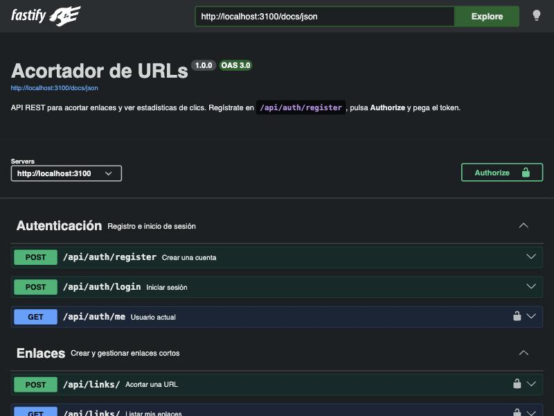

# Acortador de URLs

API REST para acortar enlaces y medir sus clics, construida con **Node.js, Fastify y TypeScript** sobre **PostgreSQL** y **Redis**. Incluye autenticación con JWT, límite de peticiones, caché de redirecciones, estadísticas por país y dispositivo sin guardar IPs, documentación OpenAPI interactiva y tests de integración contra bases de datos reales.



## Funcionalidades

- **Enlaces cortos** con código aleatorio de 7 caracteres o **alias personalizado** (`/mi-github`).
- **Caducidad y desactivación:** un enlace caducado o desactivado responde `410 Gone`.
- **Edición del destino** sin cambiar el enlace corto.
- **Estadísticas** de los últimos N días: clics por día, visitantes únicos, país, dispositivo, navegador, sistema operativo y sitio de origen. Los **bots** (previsualizaciones de WhatsApp, buscadores, curl…) se cuentan aparte.
- **Autenticación** con JWT. Cada usuario solo ve sus enlaces; los ajenos responden `404`, para no revelar que existen.
- **Rate limiting** compartido en Redis: 120 peticiones/min en general, 10/min en login y registro, 30/min para crear enlaces (por usuario).
- **Documentación OpenAPI** generada desde los mismos esquemas que validan las peticiones, en `/docs`.

## Arquitectura

```
                ┌──────────────────────────── Fastify ────────────────────────────┐
 GET /:code ──► │ redirect ──► LinkService.resolve ──► Redis (caché) ──► PostgreSQL│
                │      │                                                           │
                │      └──► 302 al destino  ·  recordClick() en segundo plano ────►│ clicks
                │                                                                  │
 /api/auth  ──► │ auth (JWT) ──► UserService ──────────────────────────► users    │
 /api/links ──► │ links ──► LinkService / StatsService ────────────────► links    │
                │ rate limit (Redis) · validación TypeBox · OpenAPI                │
                └──────────────────────────────────────────────────────────────────┘
```

### Decisiones de diseño

| Decisión | Por qué |
| --- | --- |
| **Redirección 302** en lugar de 301 | Con un 301 el navegador recuerda la redirección y las siguientes visitas no pasan por el servidor: no se contarían y no se podría cambiar el destino. |
| **Caché en Redis** de `código → destino` (1 h) | La redirección es la ruta más usada. Los códigos inexistentes también se cachean (60 s) para que probar códigos al azar no sature PostgreSQL. Editar o borrar un enlace invalida su entrada. |
| **El clic se guarda sin bloquear** la respuesta | El usuario no espera a las estadísticas. Las escrituras pendientes se registran y se esperan al cerrar el servidor, así un apagado (`SIGTERM`) no pierde clics. |
| **Sin guardar IPs** | Para los visitantes únicos se guarda un HMAC de IP + user agent + día con un secreto del servidor. Permite contar sin almacenar datos personales y cambia cada día. |
| **País por cabeceras de CDN** (`CF-IPCountry`, `X-Vercel-IP-Country`…) | En producción, Cloudflare, Vercel o CloudFront ya resuelven el país. Así no hace falta una base de datos GeoIP de más de 100 MB dentro de la imagen. |
| **Códigos base62 con rejection sampling** | `byte % 62` favorecería a algunos caracteres porque 256 no es múltiplo de 62. Se descartan los bytes ≥ 248 para que la distribución sea uniforme. |
| **Validación del destino** | Solo `http(s)`. Se bloquean `javascript:`, los bucles hacia el propio acortador y las IPs privadas o `localhost`, para que nadie lo use para apuntar a redes internas. |
| **Contraseñas con scrypt** (incluido en Node) | Usa los parámetros que recomienda OWASP, compara en tiempo constante y no necesita compilar dependencias nativas como bcrypt. |
| **Migraciones con advisory lock** | Si arrancan varias instancias a la vez, solo una aplica las migraciones. |

## Puesta en marcha

### Con Docker (todo incluido)

```bash
docker compose up --build
```

La API queda en <http://localhost:3000> y la documentación en <http://localhost:3000/docs>.

### En local para desarrollo

Requiere Node.js 22 o superior y Docker (para PostgreSQL y Redis).

```bash
cp .env.example .env
docker compose up -d db redis
npm install
npm run dev
```

## Ejemplo de uso

```bash
# 1. Crear una cuenta (devuelve un token)
curl -X POST localhost:3000/api/auth/register \
  -H 'content-type: application/json' \
  -d '{"email":"ana@ejemplo.com","password":"una-contraseña-segura"}'

# 2. Acortar una URL
curl -X POST localhost:3000/api/links \
  -H "authorization: Bearer $TOKEN" -H 'content-type: application/json' \
  -d '{"url":"https://github.com/Jorgedngc","alias":"mi-github"}'
# → {"code":"mi-github","shortUrl":"http://localhost:3000/mi-github", ...}

# 3. Usarla
curl -i localhost:3000/mi-github
# → HTTP/1.1 302 Found · location: https://github.com/Jorgedngc

# 4. Ver sus estadísticas
curl "localhost:3000/api/links/mi-github/stats?days=30" -H "authorization: Bearer $TOKEN"
```

Respuesta de estadísticas (resumida):

```json
{
  "periodDays": 30,
  "totalClicks": 3,
  "uniqueVisitors": 2,
  "botClicks": 1,
  "clicksByDay": [{ "date": "2026-11-01", "clicks": 3 }],
  "countries": [{ "value": "MX", "clicks": 2 }, { "value": "ES", "clicks": 1 }],
  "devices": [{ "value": "mobile", "clicks": 2 }, { "value": "desktop", "clicks": 1 }],
  "browsers": [{ "value": "Safari", "clicks": 2 }, { "value": "Chrome", "clicks": 1 }],
  "referrers": [{ "value": "twitter.com", "clicks": 1 }]
}
```

## Endpoints

| Método | Ruta | Descripción |
| --- | --- | --- |
| `POST` | `/api/auth/register` | Crear cuenta |
| `POST` | `/api/auth/login` | Iniciar sesión |
| `GET` | `/api/auth/me` | Usuario actual 🔒 |
| `POST` | `/api/links` | Acortar una URL 🔒 |
| `GET` | `/api/links?page=1&limit=20` | Listar mis enlaces 🔒 |
| `GET` | `/api/links/:code` | Ver un enlace 🔒 |
| `PATCH` | `/api/links/:code` | Editar destino, estado o caducidad 🔒 |
| `DELETE` | `/api/links/:code` | Eliminar 🔒 |
| `GET` | `/api/links/:code/stats?days=30` | Estadísticas 🔒 |
| `GET` | `/:code` | Redirección |
| `GET` | `/health` | Estado de PostgreSQL y Redis |
| `GET` | `/docs` | Documentación interactiva |

🔒 = requiere `Authorization: Bearer <token>`

## Tests

59 tests con Vitest:

- **Unitarios:** generación y distribución de códigos, validación de URLs (esquemas, IPs privadas, bucles), parser de user agent, hash de visitantes y contraseñas.
- **Integración:** la app completa con `app.inject()` contra **PostgreSQL y Redis reales**, en una base de datos aparte. Cubren registro y login, límite de intentos, CRUD, paginación, aislamiento entre usuarios, invalidación de caché al editar, respuestas 404/410, estadísticas con bots excluidos y que no se guardan IPs.

```bash
docker compose up -d db redis
npm test
```

En GitHub Actions los tests corren con PostgreSQL y Redis como servicios, y además se construye la imagen Docker.

## Estructura

```
src/
├── app.ts              # construcción de la app (plugins, errores, rutas)
├── server.ts           # arranque, migraciones y cierre ordenado
├── config.ts           # variables de entorno
├── schemas.ts          # esquemas TypeBox → validación + OpenAPI
├── db/                 # migraciones
├── routes/             # auth, links (+ stats), redirect
├── services/           # lógica y SQL: users, links, stats
└── lib/                # códigos, URLs, user agent, visitantes, contraseñas
test/                   # unitarios e integración
```

## Tecnologías

Node.js 22 · TypeScript · Fastify 5 · PostgreSQL 17 · Redis 7 · TypeBox · JWT · OpenAPI / Swagger UI · Vitest · Docker · GitHub Actions

## Licencia

[MIT](LICENSE)
